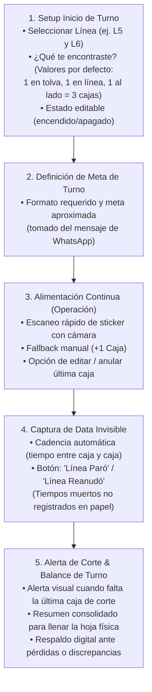

# ESC-01: Abastecimiento de Tolvas para Líneas de Producción en SMI

> [!NOTE]
> **ESTADO DEL ESCENARIO:** `Especificación Funcional Completa / Pendiente Fotos de Formatos`  
> **ÁREA:** Planta Pucusana — Abastecimiento de Preformas a Línea  
> **JURISDICCIÓN:** 100% Operativa (Uso propio del operario/ayudante; sin invasión de oficina ni de TI).  
> **ESCALA:** 6 Líneas de Producción (~6 a 7 operarios activos por turno, ~50 cajas/operario/turno).

---

## 1. Justificación Táctica y Blindaje de Seguridad de Datos

### 🛡️ Protocolo Anti-Riesgo Laboral y de Ciberseguridad
Para evitar cualquier contingencia, reclamo de *Shadow IT*, sanción o acusación de vulneración de datos industriales de Arca Continental o SMI:
1. **Arquitectura Local-First (Offline Storage):**
   - La aplicación corre en el navegador del teléfono como Progressive Web App (PWA).
   - Todos los registros se guardan primariamente en el almacenamiento local del teléfono (`IndexedDB` / `LocalStorage`).
   - **Ningún dato sensible sale a la nube sin control:** no hay llamadas a APIs externas en tiempo real que puedan ser auditadas como fuga de información.
2. **Anonimización Estricta (Data Sanitization):**
   - No se almacenan marcas comerciales ni nombres corporativos (*Coca-Cola*, *Arca*, *SMI*, etc.).
   - Se utilizan identificadores industriales abstractos: `L1` a `L6` (Líneas), `F-500` / `F-1500` (Formatos), conteo de cajas y timestamps numéricos.
3. **La Coartada de la "Herramienta Personal":**
   - Frente a cualquier supervisor o compañero, la app se presenta como una *«calculadora / bitácora de notas digital para no olvidar el conteo físico y evitar que se pase la tolva»*.
   - El personal ya comparte fotos de stickers y números de producción por WhatsApp personal no regulado. Una libreta digital local es inofensiva y demuestra proactividad operativa.

---

## 2. Flujo Funcional Detallado de la Aplicación



### 📋 Módulo 1: Setup de Inicio de Turno («¿Qué te encontraste?»)
* **Líneas asignadas:** El operario selecciona una o dos líneas (ej. Línea 5 y 6).
* **Condición inicial de preformas (Buffer de arranque):**
  - Permite escanear el sticker de la caja que ya quedó lista frente a la tolva.
  - **Valores por defecto inteligentes (editables en 1 toque):**
    * Caja lista frente a máquina: `1 caja` (por defecto).
    * Dentro de tolva: `1 caja` (por defecto).
    * En tránsito en línea: `1 caja` (por defecto).
    * *Total acumulado al inicio:* `3 cajas`.
  - Si la línea estuvo apagada o vacía, un switch rápido permite poner todo en `0 cajas`.

### 📦 Módulo 2: Registro de Cajas & Escaneo de Stickers
* **Entrada Rápida:**
  - **Opción A (Cámara):** Escaneo rápido del código del sticker de la caja.
  - **Opción B (Manual):** Botón táctil gigante `+1 Caja` si el sticker está roto, manchado o con prisa.
* **Control de Errores (Poka-Yoke):**
  - Botón de deshacer / eliminar última caja por si se escaneó dos veces por accidente.
* **Cálculo de Saldo en Vivo:**
  - Muestra barras de avance: *Cargadas: 18 / Faltan: 32*.

### ⏱️ Módulo 3: Captura de "Data Invisible" (Cadencia y Tiempos Muertos)
* **Cadencia de Máquina:**
  - Cada vez que se registra una caja, el sistema guarda el timestamp exacto.
  - Se calcula el delta de minutos entre caja y caja para conocer la velocidad real de consumo de la tolva.
* **Botón de Parada de Línea (Tiempos Muertos):**
  - Dos botones simples: `⚠️ Línea Paró` y `▶️ Reanudó`.
  - Genera un registro exacto de minutos perdidos por problemas mecánicos, falta de preforma o cambio de turno, data que hoy **no existe en ningún Excel administrativo**.

### 🏁 Módulo 4: Balance de Turno & Llenado de Hoja Física
* Al cerrar el turno, la app entrega el resumen ordenado:
  - Formato, total de cajas, preformas equivalentes, hora de inicio/fin y códigos HU.
  - El operario usa este resumen para transcribir su hoja impresa de forma rápida y sin errores de memoria.

---

## 3. Modelo de Datos Local / Sincronizable

```typescript
// Estructura de almacenamiento local (IndexedDB / LocalStorage)
interface ShiftSetup {
  shiftId: string;
  date: string;
  lineNumber: number;          // 1 a 6
  formatCode: string;          // Ej: 'F-500'
  initialHopperBoxes: number;  // Default: 1
  initialLineBoxes: number;    // Default: 1
  initialReadyBoxes: number;   // Default: 1
  targetUnits: number;         // Ej: 50000
}

interface BoxEntry {
  boxId: string;
  shiftId: string;
  timestamp: string;           // ISO DateTime
  huCode?: string;             // Handling Unit escaneado
  lotNumber?: string;
  deltaMinutesFromLastBox: number; // Cadencia calculada
}

interface LineDowntimeEvent {
  eventId: string;
  shiftId: string;
  stoppedAt: string;
  resumedAt?: string;
  durationMinutes?: number;
  reason?: string;
}
```

---

## 4. Evolución hacia Power BI (Fase 2)

Cuando se consolide la data local anonimizada, se conecta o exporta hacia Power BI para generar tableros inéditos de planta:
1. **Curva de Cadencia por Máquina:** Comparativa de velocidad de consumo de tolvas entre líneas.
2. **Distribución de Tiempos Muertos:** Gráfico de Pareto de minutos perdidos por paradas en tolva.
3. **Precisión de Corte:** Desviación entre la meta solicitada y las preformas consumidas (reducción de saldos remanentes).
