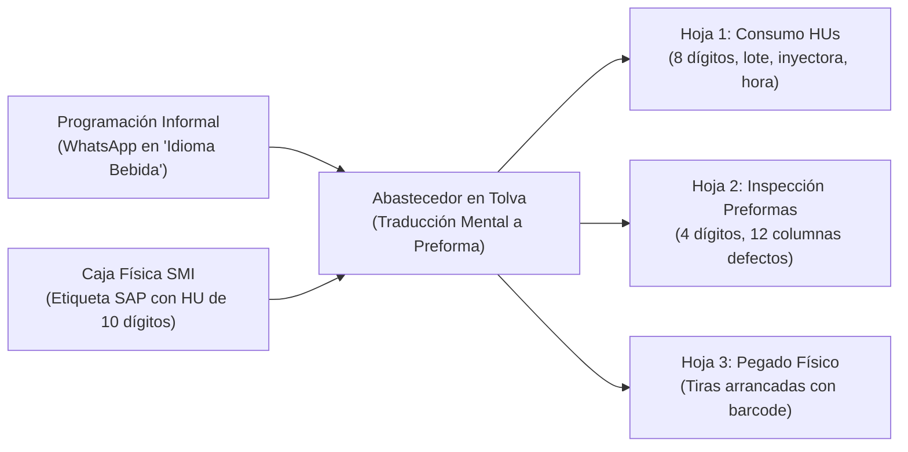

# ESC-01: Control de Consumo e Inspección de HUs de Preformas en Tolvas de Soplado (SMI - Planta Pucusana)

> [!NOTE]
> **ESTADO DEL ESCENARIO:** `Especificación Operativa Completa & Base de Incepción Validada`  
> **ÁREA:** Operaciones In-House SMI en Planta Embotelladora Arca Continental Lindley (Pucusana).  
> **ALCANCE FÍSICO:** 6 Líneas exclusivas de producción PET (`Línea 3, 4, 5, 6, 8 y 9`) distribuidas en **3 Turnos (`Turno I, Turno II, Turno III`)**.  
> **JURISDICCIÓN:** 100% Operativa en tolvas de soplado (Abastecimiento de bines/cajas de preformas plásticas a la tolva elevadora).

---

## 1. Contexto Operativo y Realidad de Planta

El proceso de abastecimiento de preformas a las sopladoras de botellas en planta Pucusana es una operación continua de alta cadencia. Las líneas no procesan el mismo formato eternamente: a lo largo de un turno pueden operar en modalidad **"Todo el turno"** (un solo producto) o tener **"Cortes y Cambios de Formato"** programados (ej. producir 89,000 botellas de un producto y cambiar de inmediato a otro).

### A. Los Actores Involucrados (Firmas de Responsabilidad en Formatos)
1. **Abastecedor (SMI):** Personal operativo que traslada los bines con transpaleta/estibador, verifica el sticker de la caja, alimenta la tolva elevadora y llena las planillas de control.
2. **Operador (Línea Arca/SMI):** Encargado de monitorear los parámetros del panel de control de la sopladora/llenadora.
3. **Líder de Turno (SMI):** Supervisor operativo responsable de transmitir la programación de producción, contingencias y metas de corte enviadas por la jefatura.
4. **Asistente Auxiliar:** Personal técnico o de calidad que valida la conformidad de la planilla de inspección de preformas.

---

## 2. Radiografía del Flujo de Información Físico y sus Brechas

El flujo manual actual adolece de fricciones cognitivas y redundancia de datos:



### A. El Input de Programación (WhatsApp)
El líder de turno transmite la programación mediante mensajes de texto en "idioma bebida":
> * `Línea 3: San Luis 750 - todo el turno`
> * `Línea 4: Ik 500 zero - 89 000 botellas y cambia a Ik 600 zero`
> * `Línea 5: Ik 2250 clásica - 60 000 botellas y cambia a Ik 1.5 clásica`
> * `Línea 6: Cc 600 clásica - todo el turno`
> * `Línea 8: San Luis 500 sin gas - ya pasamos la cantidad - corta y cambia a san Luis 3000`
> * `Línea 9: Ik 600 clásica - 78 000 botellas y cambia a Ik 3000 clásica`

### B. El Insumo Físico (Etiqueta SAP de SMI pegada en la caja)
Cada contenedor de preformas trae una etiqueta estándar con los siguientes campos clave:
* **DESCRIPCIÓN:** Gramaje, color, rosca y proceso (ej. `15.7Cel.1881 CM` para San Luis 750ml, `17.7 Cr.1881 CM` para Inca Kola 500ml Zero).
* **CÓDIGO SAP:** Identificador de material (ej. `0015701B0U0`, `00177004025`).
* **FECHA:** Fecha de fabricación de la preforma (ej. `05.10.26`, `16.10.26`).
* **LOTE / BATCH:** Código alfanumérico compuesto por fecha invertida + tipo de resina + inyectora + turno (ej. `261005Z17M`).
* **TIPO / LÍNEA:** Tipo de resina/empaque (ej. `Z-CP`, `G-CP`) y máquina inyectora de origen (ej. `Y17`, `Y25`).
* **UNIDADES (Dato crítico de variabilidad):** La cantidad de preformas por caja no es fija. Depende del tamaño/densidad del formato:
  * Formatos pequeños: ~`19,555` a `19,571` unidades/caja.
  * Formatos grandes (2.25L o 3L): ~`8,000` unidades/caja.
* **PESO BRUTO / PESO NETO:** Registro de pesaje (Tara estándar de caja: `80.500 kg`).
* **CAJA NO (HU):** Código Handling Unit único de 10 dígitos (ej. `1062206055`, `1062513875`), impreso en número y en código de barras lineal 1D (Code 128).

---

## 3. Análisis de los Documentos Físicos Manuales (El Triple Registro)

Al terminar el turno, el abastecedor entrega un legajo físico compuesto por 3 caras:

### Cara 1: Formato "Control de Consumo de HUs de Preformas" (`PTP.R.2.PER.SO.4`)
* **Cabecera:** Fecha (`DD-MM-AA`), Sopladora (`03`), Turno (`I`), Formato/Producto (`San Luis 750 ml`), Gramaje/Color (`15.7 celeste`), Orden de Fabricación (OF).
* **Estructura:** Dos bloques de formato y dos tablas de 30 filas cada una (Columnas: Izquierda 1..30, Derecha 1..30).
* **Columnas llenadas por fila:**
  1. `ITEM`: Correlativo 1..30.
  2. `HORA`: Hora anotada (generalmente calculada a ojo al cierre del turno).
  3. `NUMERO DE HU`: Los **8 últimos dígitos** del HU (se omite el prefijo `10`, ej. `62206055`).
  4. `LOTE`: Se escribe el campo **`TIPO`** del sticker sin guión (`ZCP`).
  5. `Inspección de bolsa (C/NC)`: Siempre marcan `C` (Conforme).
  6. `MAQUINA INYEC`: Número de inyectora omitiendo la letra `Y` (`17`).
  7. `FECHA FAB. PREF`: Día y mes de fabricación (`05-10`, `06-10`).
  8. `UND`: Unidades exactas de la caja (`19555`).
  9. `TERMINAL`: Los **últimos 4 caracteres del código SAP** (`B0U0` o `4025`).
* **Pie:** Kilos de desperdicio de preformas/botellas y firmas de *Abastecedor*, *Operador* y *Líder de Turno*.

### Cara 2: Formato "Planilla de Inspección de Preformas" (`PTP.R.7.PER.SO.7`)
* Formato duplicado para registrar calidad.
* **Columnas:** `Hora`, `N° Caja` (aquí solo escriben los **4 últimos dígitos**, ej. `6055`), `Turno` (`1`), `Máquina Inyectora n°` (`17`).
* **12 Columnas de Defectos de Calidad:**
  * **Zona ROSCA:** `Aro Mordido`, `Incompleta`, `Rebaba`.
  * **Zona CUERPO:** `Cuello hundido`, `Nube ligera`, `Porosidad`, `Raspado en el cuerpo`, `Círculo blanco`, `Domo achatado`, `Punto de inyección con hueco`, `Punto inyección quemado`, `Raspado en el punto de inyección`, `Otros`.
  * *Realidad operativa:* Por falta de tiempo, el operario traza una línea continua indicando conformidad masiva.
* **Pie:** Firmas de *Operador*, *Abastecedor* y *Asistente Auxiliar*.

### Cara 3: Reverso (Tiras de Códigos de Barras Pegadas)
* Las etiquetas tienen una sección troquelada abajo con el código de barras y el HU de 10 dígitos.
* El operario desprende manualmente cada tira y las pega una debajo de otra en el reverso de la hoja.

---

## 4. Vulnerabilidades y Fricciones del Proceso Físico

1. **Horas Inconsistentes y Descuadradas:** Al anotarse de memoria o al final de la jornada, la misma caja física tiene horas distintas en la Cara 1 (`8:40`) y en la Cara 2 (`8:45`).
2. **El Problema del Corte de Formato ("Ya pasamos la cantidad"):**
   * El mensaje de WhatsApp de la Línea 8 lo evidencia: *"ya pasamos la cantidad - corta y cambia a San Luis 3000"*.
   * Calcular mentalmente cuántas cajas de `19,555` o `8,000` preformas se necesitan para completar una meta en botellas (restando lo que ya está en tolva y transportador) genera sobreproducción o mermas de cambio de formato.
3. **Rigidez Burocrática del Papel:**
   * La hoja tiene 30+30 filas. Si una producción requiere 35 cajas antes de cambiar a otro formato, el operario debe anular casillas con rayas en "Z" y abrir un segundo juego de hojas completo de 3 caras, generando papelería redundante.
4. **Carga Administrativa de Digitación:**
   * Al final del día, un asistente recibe decenas de hojas físicas arrugadas y debe transcribir manualmente cada número a un libro de Excel corporativo.

---

## 5. Arquitectura de la Solución Digital (Enfoque Pragmático)

La aplicación web operará como una **herramienta de registro directo y cálculo en vivo** libre de las limitaciones físicas del papel:

```
[Móvil en Tolva]
App Web (Next.js / PWA en EasyPanel)
   ├── Catálogo Maestro Pre-cargado (Bebida <-> Preforma, Unidades, Códigos SAP)
   ├── Lector de Código de Barras 1D (Cámara web nativa, < 1 seg)
   ├── Fallback Manual (Digitar 8 dígitos del HU si sticker está dañado)
   └── Cálculo Automático de Cajas Faltantes y Sincronización de Horas
           │
           ▼
[Persistencia Cloud]
PostgreSQL en Supabase (Tablas relacionales: perfiles, turnos, bloques, hus)
           │
           ├──► [Salida Inmediata 1] Exportación a Excel (.xlsx) idéntico a formatos para digitador
           └──► [Salida Inmediata 2] Conexión directa nativa a Power BI Desktop para dashboards gerenciales
```

* **Cero Complejidad OCR en el MVP:** El catálogo de formatos se gestiona y precarga en base de datos. Para registrar una caja, el operario solo apunta al código de barras 1D de la tira desglosable (que devuelve el HU en milisegundos) y el sistema hereda lote, inyectora y fecha del bloque activo.
* **Modelo Continuo de Datos:** Da igual si son 10, 35 o 60 cajas; se registran en flujo continuo agrupadas por bloque de producto.
* **Preparado para Roles:**
  * *Fase 1 (Ultra-MVP):* El abastecedor maneja sus turnos y registra sus cajas.
  * *Fase 2 (Supervisión):* El líder de turno programa las metas centralizadamente e interactúa con avisos en caliente.
