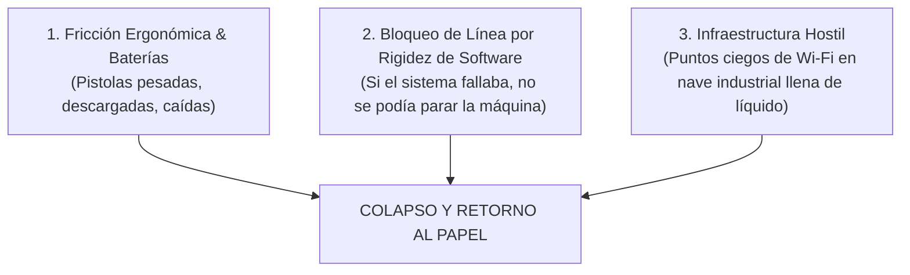
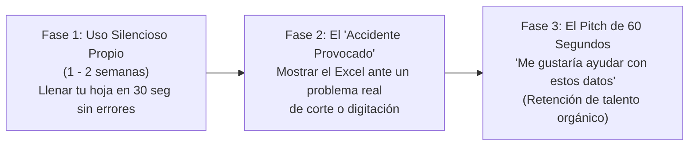

# Estrategia Táctica de Abordaje y Presentación al Jefe de Planta (SMI - Arca Pucusana)

> [!NOTE]
> **OBJETIVO ESTRATÉGICO:**  
> Posicionar a Christopher frente a la jefatura no como un operario que "vende una app", sino como un **recurso técnico de alto valor (Platform / Data Engineer)** que resuelve problemas de mermas, discrepancias y digitación manual, abriendo el camino para trabajar formalmente con los datos de planta o habilitar una transición de rol.

---

## 1. Arqueología del Fracaso: ¿Por qué falló el proyecto anterior de las "Pistolas"?

El dato de que ya intentaron usar pistolas y volvieron al papel es **la pieza de inteligencia más valiosa que has obtenido**. En plantas continuas de embotellado masivo, los intentos de digitalización casi nunca fracasan por rechazo a la tecnología en abstracto, sino por el **"Triángulo de Muerte de la Tecnología Industrial"**:

### Hipótesis 1: El Síndrome del "Equipo Compartido" (Fricción de Hardware)
* Las terminales de radiofrecuencia (Zebra, Honeywell) son caras (\$1,000 - \$2,500).
* En el piso de planta se convierten en foco de quejas:
  * El turno saliente las dejaba sin cargar o no las dejaba en la base.
  * Se caían al piso, se ensuciaban con grasa/polvo o se descalibraban los lectores láser.
  * Al no tener un "dueño individual", nadie se responsabilizaba. Si a las 2:00 a.m. la pistola no encendía, el operario **no podía frenar la sopladora**: sacaba el lapicero y volvía a llenar la hoja en papel.

### Hipótesis 2: Rigidez de Validación (Software Punitivo sin Fallback)
* Los sistemas corporativos tipo SAP WM son binarios: si el código de barras no calza exactamente con la Orden de Fabricación liberada, la terminal pita en rojo y bloquea la operación.
* En el piso real, donde entran bines con etiquetas rotas, manchadas o cambios de lote de emergencia, el operario no tiene 15 minutos para llamar a Sistemas. Si la herramienta no le permite resolver rápido, se abandona.

### Hipótesis 3: La Pesadilla de Conectividad en Planta (Wi-Fi vs. Acero y Agua)
* Las naves embotelladoras son el peor entorno para radiofrecuencia: estructuras densas de acero, motores masivos de alta tensión y miles de litros de agua en movimiento.
* Si la pistola dependía de conexión Wi-Fi ininterrumpida al servidor local y en la zona de tolva la señal fluctuaba, la sesión se cerraba a mitad de escaneo, generando frustración inmediata.

---

## 2. Radiografía de Vulnerabilidades de tu Solución y Blindaje Técnico

Para defender tu propuesta sin titubear, debes anticipar las objeciones que pondrá un jefe de planta o un supervisor técnico:

| Vulnerabilidad Percibida | Realidad Técnica | Blindaje Táctico (Tu Respuesta) |
| :--- | :--- | :--- |
| **"Depende de Internet / Nube (Supabase en AWS)"** | Si el chip móvil pierde señal en la nave, la web podría fallar al guardar. | **Solución Técnica:** Implementar almacenamiento local offline (`IndexedDB` / Local-First). La app guarda todo en el teléfono en milisegundos y sincroniza en segundo plano cuando detecta red. |
| **"Uso de celular personal en línea de producción"** | Muchas plantas prohíben formalmente el celular en piso por seguridad y riesgo de caídas a la tolva. | **Coartada Operativa:** El personal ya usa el celular para recibir los mensajes de WhatsApp de metas y fotos de stickers. La app se presenta como una "calculadora de corte" personal, no como un distractor. |
| **"Shadow IT / Fuga de Datos"** | TI corporativa rechaza software de terceros no auditado. | **Cero Intrusión:** La solución no toca la red interna de la planta, no pide contraseñas de SAP ni extrae datos financieros. Solo procesa los mismos códigos y conteos que hoy están escritos a mano en hojas abiertas a la vista de todos. |

---

## 3. Estrategia de Abordaje: "La Demostración Silenciosa"

> [!IMPORTANT]
> **REGLA DE ORO CORPORATIVA:**  
> A un Jefe de Planta **NUNCA le pidas permiso para implementar una app**. A un Jefe de Planta se le muestra **un dolor operativo resuelto que le ahorra problemas de presupuesto, mermas o auditorías**.

Al jefe de planta no le interesa qué framework usaste; le importan 3 cosas:
1. **Que Arca Continental no les meta reclamos por pasarse de botellas** (como ocurrió en la Línea 8: *"ya pasamos la cantidad - corta y cambia"*).
2. **Que las planillas de calidad y producción no tengan inconsistencias horarias** ante una auditoría.
3. **Que el cierre de mes no sea un infierno de transcripción manual** para el asistente/digitador.

### Las 3 Fases de la Jugada:

### Fase 1: Perfección Silenciosa en tu Turno
* Usa la aplicación para tu propia operación. Que tu hoja física sea sistemáticamente **la más pulcra, con las horas 100% cuadradas y cortes exactos al milímetro**.
* Si el turno anterior se pasó de botellas por 2 cajas, tú demuestras que en tu turno el corte cayó en el número exacto porque calculaste la densidad del formato (`19,555` vs `8,000` preformas/caja).

### Fase 2: El "Accidente Provocado" (Resolver un dolor ajeno)
No busques al jefe en su oficina en frío. Espera a que surja uno de estos dos momentos orgánicos:
* **Momento A (Discrepancia en piso):** El supervisor o digitador busca explicaciones: *«¿Por qué en la Línea 4 no coinciden las horas de inspección con las de consumo?»*
* **Momento B (Cierre de turno / reporte):** Al entregar tus hojas o al conversar con el digitador que está saturado pasando papeles a Excel.

Ahí **NO dices**: *"Hice una aplicación web"*.  
Dices:  
> *"Ingeniero / Supervisor, vi que en los cambios de formato siempre hay riesgo de pasarnos de botellas o equivocarnos en las horas entre las dos hojas. Para asegurarme de no fallar en mi turno, me armé una plantilla de control personal. De hecho, aquí tengo el reporte consolidado con los minutos exactos entre caja y caja de toda la guardia."*

### Fase 3: El Pitch de 60 Segundos al Jefe de Planta
Cuando el jefe o supervisor vea el consolidado (en Excel exportado o en el tablero de Power BI con datos reales e impecables):

> *"Ingeniero, tengo entendido que en el pasado se intentó usar pistolas y que se volvió al papel porque en la práctica eran pesadas, se descargaban o trababan la operación.  
> Yo tengo formación en ingeniería de software y análisis de datos. Entré a la planta como operario justamente para entender el proceso desde el piso real, y preparé esta herramienta ligera para que el registro tome 1 segundo sin interrumpir el soplado y garantice que el papel físico se llene sin contradicciones.  
> Mi compromiso con mi puesto operativo está al 100%, pero si a la planta le es útil, **me gustaría poner mis conocimientos a disposición para ayudar a estructurar estos reportes y automatizar la consolidación con los Excels del área**, sin ningún costo de licencias ni fricción para los compañeros."*

---

## 4. Por qué este enfoque te garantiza ganar en cualquier escenario

1. **Si el Jefe tiene visión y apertura:**  
   Verá a un operario que no se queja, que entiende los dolores de producción, que respeta la jerarquía y que resolvió con ingenio propio lo que costosos proyectos previos no lograron. Eso te posiciona de inmediato en el radar para proyectos de optimización, soporte de reportes o una reubicación hacia análisis de datos/control de producción.
2. **Si el entorno es ultraconservador o indiferente:**  
   No habrás arriesgado nada: no violaste políticas, no impusiste nada a tus compañeros y no dependiste de la aprobación de nadie para que tu trabajo diario sea más eficiente.  
   Y lo más importante: **te quedas con un caso de estudio real de alto impacto**, con métricas de una mega-planta industrial (Arca Continental / SMI), documentado de forma intachable para defender en entrevistas externas de *Platform Engineer*, *Data Engineer* o *AI Developer*.

---

## 5. Protocolo de Gestión Social y Control de Fricción con Compañeros de Turno

> [!WARNING]
> **REGLA DE SUPERVIVENCIA EN PISO INDUSTRIAL:**
> En un entorno de operarios de planta, **la tecnología individual no autorizada genera sospecha y fricción inmediata**. 
> Si los compañeros empiezan a comentar en los pasillos que *"el nuevo está usando una app para registrar cajas"*, el rumor mutará rápidamente a:
> 1. *"Nos quieren poner más trabajo o medir cuánto tardamos en cada caja."*
> 2. *"Está de sobonazo con la supervisión / se cree superior."*
> 3. *"¿Por qué él saca el celular en la tolva si a nosotros nos pueden amonestar?"*

### A. Diagnóstico del Incidente: ¿Por qué NO debes abrirles el acceso todavía?
1. **Pérdida de Control de la Narrativa y del Software:**
   * Si les das acceso con login de Google, **pierdes el control del piloto**. Si a uno de ellos se le corta la señal a las 3:00 a.m., no sabe qué botón tocar o se le duplica un HU por apurado, culpará a la app frente al supervisor y dirá que *"esa vaina no sirve"*.
2. **El Teléfono Malogrado con la Supervisión:**
   * El compañero que *"se fue de boca"* no tiene lenguaje técnico. Al contarlo a otros operarios o a un líder, puede distorsionar el mensaje (*"Christopher tiene un programa en la nube donde registra la producción"*), lo cual puede activar alarmas de ciberseguridad o disciplina antes de que tú muestres los resultados en Excel.
3. **El Contraste de Métodos:**
   * Tu flujo es infinitamente superior: preparas las cajas a un lado, las escaneas en bloque y sabes en tu celular cuál fue la última, mientras ellos pegan stickers en el fierro de la tolva (corriendo el riesgo de que se desprendan, se ensucien con grasa o se desordenen). Si intentas imponerles tu herramienta antes de tiempo, generas rechazo defensivo.

### B. El Guion de Contención Inmediata (Control de Daños con Compañeros)
A partir de hoy, si ese compañero u otro se acerca a preguntar o si alguien te dice *"oye, me dijeron que tienes un sistema en el celular"*, **debes bajarle el perfil radicalmente**:

* **QUÉ NO DECIR NUNCA:**
  * ❌ *"Hice una aplicación en la nube con Supabase."*
  * ❌ *"Les puedo crear un usuario para que ustedes también lo usen."*
  * ❌ *"Esto es para modernizar el papel y los stickers."*

* **EL DISCURSO DE BLINDAJE (Bajo Perfil / Coartada Humilde):**
  * ✅ *"No causa, ¿qué sistema va a ser? Es un bloc de notas / formulario básico que me armé para mí mismo porque soy bien despistado con los números y el otro día casi se me cae un sticker del fierro de la tolva. Para no hacerme bolas con las horas ni equivocarme en la hoja de papel, me lo anoto aquí primero. Es solo mi machete personal para no regarla en mi turno."*

### C. La Regla de los Tres Círculos de Confianza
1. **Círculo 1 (Tú solo - Activo):** Por los próximos 10 a 14 días, **la app es 100% de uso privado para tu propia guardia**. No compartas enlaces ni crees cuentas a terceros.
2. **Círculo 2 (El Compañero Aliado):** Si haces mancuerna fija con un compañero de confianza en tu línea y ves que se enreda con las tiras de stickers, puedes ayudarle tú directamente (*"pásame la tira y yo te apunto los números en mi libreta para que no te atrases"*), pero **siempre operándolo desde tu propio teléfono**.
3. **Círculo 3 (La Jefatura / Formalización):** La apertura a otros operarios **solo ocurrirá cuando el jefe de planta o el líder de turno lo autorice formalmente como piloto oficial tras ver el reporte en Excel**. En ese momento ya no serás *"el compañero que se corta solo"*, sino *"el facilitador de una mejora aprobada por la jefatura"*.
